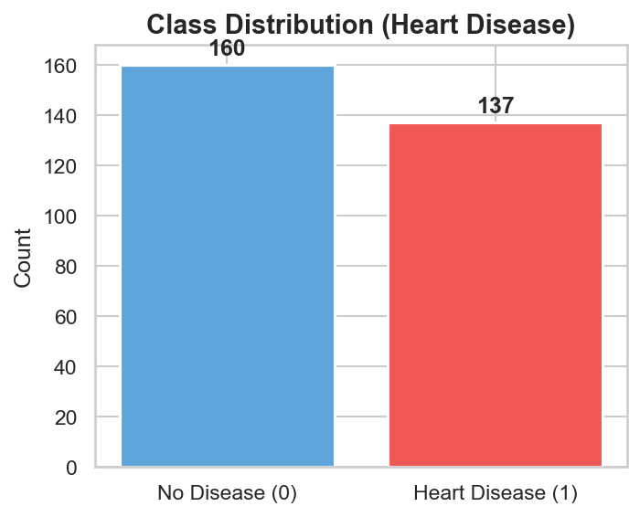
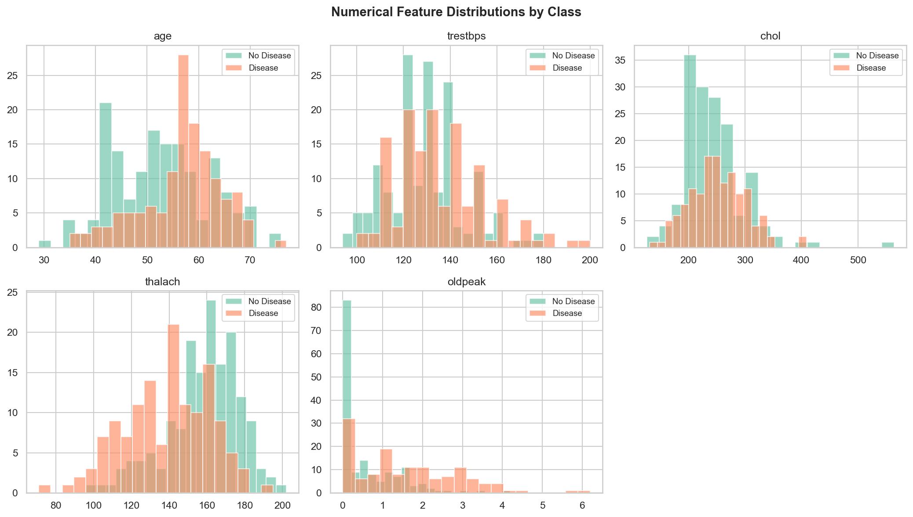
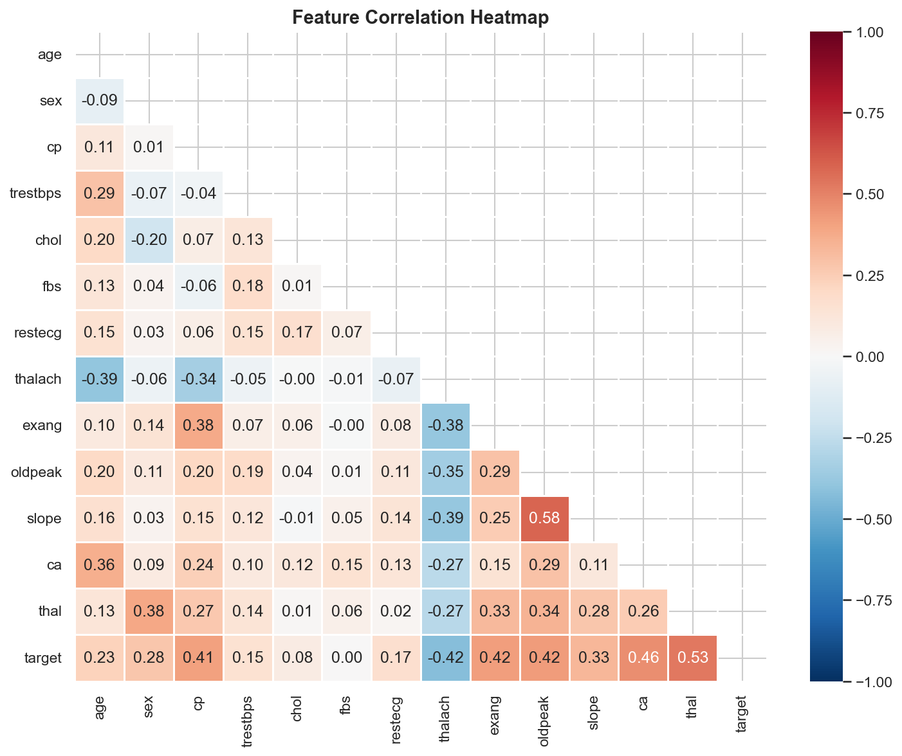
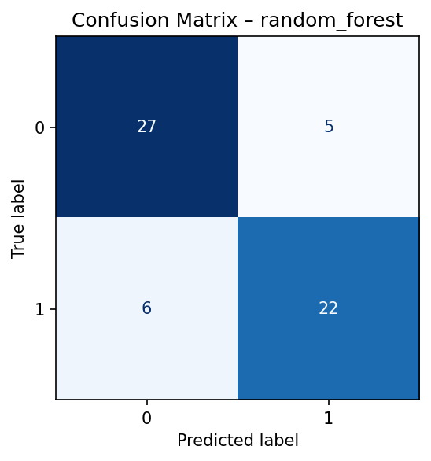
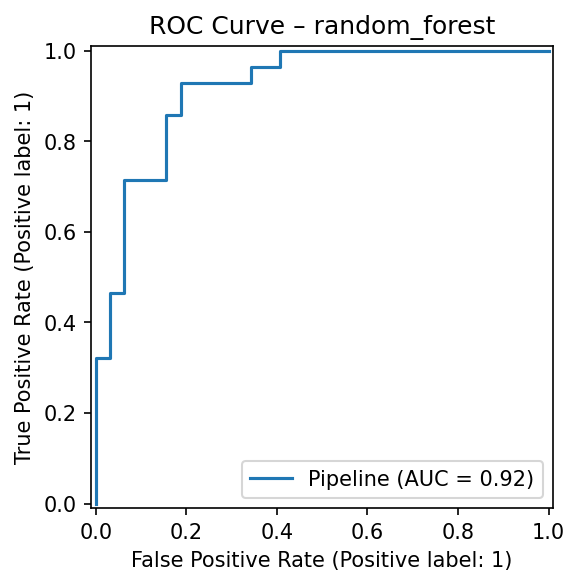
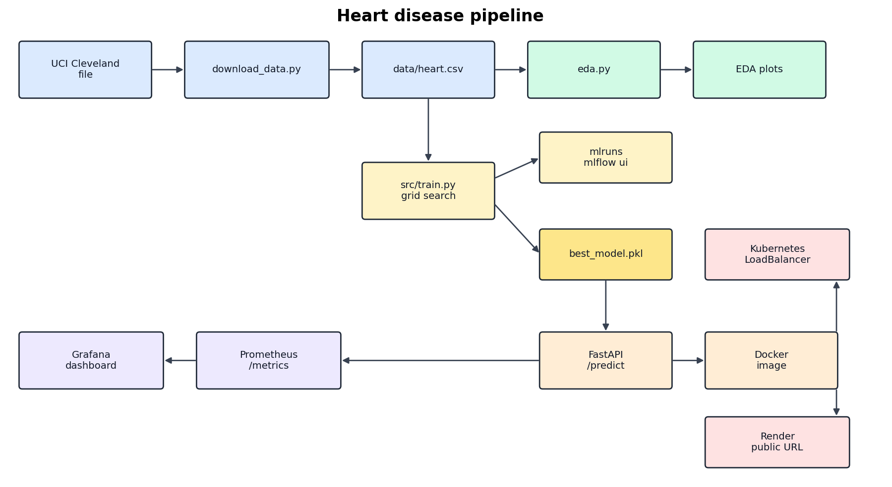

# Heart Disease Classifier: Training, Tracking, and a Small API

AIMLCZG523, Assignment 01  
Repository: https://github.com/rnagaraj13/mlops_assignment

## 1. What I built

I trained a binary classifier on the Cleveland heart-disease file from UCI and wrapped the saved model in a FastAPI service. The dataset is only a few hundred rows, so I did not spend time chasing a more complicated model. I spent it on being able to clone the repo on a lab PC and get back to a working `/predict` without fixing paths by hand.

The pieces are ordinary:

- `data/download_data.py` pulls the UCI file and writes `data/heart.csv`
- `notebooks/eda.py` saves the plots
- `src/train.py` compares logistic regression and a random forest, logs both in MLflow, and writes `models/best_model.pkl`
- `api/app.py` loads that pickle
- Docker and the YAML files under `k8s/` run the same API
- Prometheus and Grafana read `/metrics` when I start the compose file

Render is only the public copy of the API. MLflow stays on the machine where I train. I open it with `mlflow ui` from the repo folder.

## 2. Setup

Use Python 3.11 or 3.12. I first tried the system Python on my laptop, which was 3.14, and `numpy==1.26.4` would not install. The lab image should be 3.11.

```bash
git clone https://github.com/rnagaraj13/mlops_assignment.git
cd mlops_assignment
python3.11 -m venv .venv
source .venv/bin/activate
pip install -r requirements.txt
python data/download_data.py
python notebooks/eda.py
python src/train.py --data data/heart.csv --experiment heart-disease
mlflow ui --port 5000
```

Leave that UI running. In another terminal, same virtualenv:

```bash
pytest tests/ -v --cov=src --cov=api
python src/evaluate.py --data data/heart.csv --model models/best_model.pkl
uvicorn api.app:app --port 8000
```

`data/heart.csv` and `models/best_model.pkl` are already in the repo, so the image still builds if the UCI site is blocked in the lab. Training overwrites the pickle and creates a new `mlruns/` folder. I left `mlruns/` out of git. It is local to whichever machine ran `train.py`.

`docker compose up -d` starts the API, Prometheus, and Grafana. It does not start MLflow. I had a second MLflow server in compose at one point and it came up empty, because training writes to the local `mlruns/` folder, not to that container. It also takes port 5000, which is the port I want for `mlflow ui`. That service is still in the file, under the `tracking-server` profile, and I do not start it for the demo.

Docker and Minikube commands are in the README. Stop `uvicorn` before `docker run` if both want port 8000.

## 3. Data

The file is the processed Cleveland extract:

https://archive.ics.uci.edu/ml/machine-learning-databases/heart-disease/processed.cleveland.data

There is no header. Missing values are `?`. The script names the 14 columns, drops rows with `?`, and turns the target into 0 or 1. In the raw file the target goes from 0 to 4. Anything above 0 is disease.

The first download failed with `CERTIFICATE_VERIFY_FAILED`. That was the python.org install on my Mac, which does not use the system certificate store. The script now uses the `certifi` bundle. Worth keeping, because a lab PC can fail the same way.

After the drop, 297 rows remain (6 removed). 160 are no disease, 137 are disease.

I kept the original Cleveland codes. A lot of public CSVs shift `cp`, `slope`, and `thal` down to start at 0. This one does not.

| Field | Codes I used |
| --- | --- |
| cp | 1 typical angina, 2 atypical, 3 non-anginal, 4 asymptomatic |
| slope | 1 upsloping, 2 flat, 3 downsloping |
| thal | 3 normal, 6 fixed defect, 7 reversible defect |
| ca | vessels coloured by fluoroscopy, 0 to 3 |
| target | 0 absent, 1 present |

The API rejects values outside those ranges. The sample request in the README is the first row of the Cleveland file, not a made-up Kaggle row.

## 4. EDA

`notebooks/eda.py` writes five plots to `notebooks/plots/`.

Class counts are 160 and 137. Close enough that I did not resample. I still used a stratified split, and I report recall and ROC-AUC with accuracy, because accuracy alone would look fine while missing the positive class.



On the histograms, max heart rate is lower for the disease class and ST depression (`oldpeak`) is higher. Age moves a bit. Cholesterol overlaps a lot.



Correlations with the target, largest first:

| Feature | Correlation with target |
| --- | --- |
| thal | 0.53 |
| ca | 0.46 |
| thalach | -0.42 |
| exang | 0.42 |
| oldpeak | 0.42 |
| cp | 0.41 |
| slope | 0.33 |
| sex | 0.28 |
| age | 0.23 |
| restecg | 0.17 |
| trestbps | 0.15 |
| chol | 0.08 |
| fbs | 0.00 |



`fbs` is basically unused by a linear model. `chol` is weak too. I left both in. Dropping them would have been a guess, and the forest can ignore a weak column on its own. The columns that actually move with the label are `thal`, `ca`, `thalach`, `exang`, `oldpeak`, and `cp`.

Two pairs are related to each other, not only to the label. Age and `thalach` correlate at -0.39. `oldpeak` and `slope` correlate at 0.58. That is why the pipeline adds `age / thalach` and `oldpeak * slope` in the next section. I did not drop either original column.

The bar charts and box plots say the same thing: asymptomatic chest pain, exercise angina, a reversible `thal` defect, and a higher vessel count show up more often in the disease class. `thalach` and `oldpeak` separate the classes more cleanly than cholesterol does.

## 5. Features

Preprocessing is only in `src/feature_engineering.py`. `data_preprocessing.py` loads the CSV and does the split. I had a second scaler there earlier and deleted it, because training and the API were not going to stay in sync if two transformers existed.

The API still receives the 13 raw fields. The extra columns are computed inside the sklearn pipeline:

- `age_thalach_ratio = age / (thalach + 1e-6)`
- `oldpeak_slope = oldpeak * slope`

Numeric columns, including those two, go through `StandardScaler`. Categorical columns go through `OneHotEncoder` with the first level dropped and unknown levels ignored. Unknown levels matter once the model is served: a bad code should not crash the process. The encoder is fit on the training fold only, because it lives inside the pipeline that `GridSearchCV` clones.

Split is 80/20, stratified, `random_state=42`. That is 237 train rows and 60 test rows. The test rows are not used to pick `C` or tree depth.

## 6. Models

I compared logistic regression and a random forest. Both are fit as a pipeline: preprocessor, then the classifier.

`GridSearchCV` runs on the training rows only, 5-fold stratified, scored on ROC-AUC.

| Model | What I searched | What won |
| --- | --- | --- |
| Logistic regression | `C` in 0.01, 0.1, 1, 10 | `C = 1.0` |
| Random forest | 100 or 200 trees, depth 4, 8, or 12, min split 2 or 5 | 200 trees, depth 4, min split 2 |

I kept the forest grid small on purpose. With 237 rows a deep tree just memorizes the fold. Depth 4 won the search, but its mean CV ROC-AUC was 0.879, below logistic regression at 0.904. If I had stopped at cross-validation I would have saved the linear model.

I then scored each fitted pipeline on the 60 held-out rows.

| Metric | Logistic regression | Random forest |
| --- | --- | --- |
| CV ROC-AUC (mean) | 0.904 | 0.879 |
| CV recall (mean) | 0.797 | 0.733 |
| Held-out accuracy | 0.783 | 0.817 |
| Held-out precision | 0.857 | 0.815 |
| Held-out recall | 0.643 | 0.786 |
| Held-out F1 | 0.735 | 0.800 |
| Held-out ROC-AUC | 0.916 | 0.917 |

Held-out ROC-AUC is 0.916 against 0.917. That is a tie on 60 rows. Recall is not: 0.643 for logistic regression, 0.786 for the forest. Logistic regression is more precise here and misses more disease cases. I saved the forest. The CV score disagreed, and I am leaving that in the report instead of only quoting the test AUC. A different seed could flip a gap this small. `random_state=42` is fixed so the lab gets this file back.

`src/evaluate.py` reloads the pickle and prints a classification report, the confusion matrix, ROC-AUC, and average precision on that same split. The two figures below are the ones MLflow stored for the forest run.





## 7. MLflow

Tracking is the local file store. `train.py` calls `mlflow.set_experiment("heart-disease")` and does not set a tracking URI, so the runs go to `./mlruns`. From the repo root, `mlflow ui --port 5000` shows them.

Each model is one run. I log the winning parameters, the search ROC-AUC, mean and std of accuracy, precision, recall, F1, and ROC-AUC from a second cross-validation on the chosen parameters, the held-out metrics, a confusion matrix, an ROC curve, and the pipeline itself (`mlflow.sklearn.log_model`).

Run IDs for the numbers in this report:

- logistic regression: `ded312e8821247a6993c6b03f1dcbf49`
- random forest: `34683af47807434f893a176572572e4c`

Training again creates new IDs. The API never talks to MLflow. Docker, Kubernetes, and Render only need the pickle.

## 8. How the model is saved

`models/best_model.pkl` is the whole pipeline, scaler and encoder included, dumped with joblib. `models/model_meta.json` has the model name and the held-out ROC-AUC and recall. `models/model_selection.json` has both candidates and the parameters the search picked.

`requirements.txt` pins numpy, pandas, scikit-learn, MLflow, FastAPI, pytest, Black, isort, Flake8, matplotlib, seaborn, and certifi. A new virtualenv plus that file is enough to run the scripts.

The Dockerfile installs the same file, then copies `src/`, `api/`, and `models/`. The pickle points at `src.feature_engineering.DerivedFeatures`, so the image has to contain that module or `joblib.load` fails inside the container. The process runs as a non-root user. The image health check hits `/health`.

## 9. Tests and GitHub Actions

Three test modules:

- `test_preprocessing.py` checks the column split, that train and test do not share rows, and that the class rate does not jump by more than 0.15.
- `test_model.py` checks the two derived columns, that the transformed matrix has no NaNs, and that both models fit and return probabilities that sum to 1.
- `test_api.py` checks `/health`, `/predict`, a missing field, a value outside the Cleveland ranges, the batch route, and `/metrics`. The model is a fake, so these tests do not need the pickle.

I got 23 passed locally.

`.github/workflows/ci-cd.yml` runs on push and on pull requests to `main`. Order is:

1. Black, isort, Flake8 on `src/`, `api/`, and `tests/`.
2. Pytest. JUnit and coverage XML are uploaded even if the tests fail.
3. On `main`: download, train, evaluate, upload `models/`.
4. Build the image, push it to GHCR, pull it back, and curl `/health`.
5. Hit the Render deploy hook if `RENDER_DEPLOY_HOOK_URL` is set.
6. Start Minikube on the runner, load `heart-disease-api:latest`, apply the manifests, and curl `/health` and `/predict`.

A failing test or a failing health check stops the workflow. That is the check I care about: a broken push should not look green.

## 10. API and Docker

`POST /predict` takes one JSON object and returns the class, the probability of disease, and a label. For the first Cleveland row:

```json
{"prediction": 0, "confidence": 0.424, "label": "No Heart Disease"}
```

The true label on that row is no disease. `GET /health` returns 503 if the pickle is missing. `GET /metrics` is plain Prometheus text: request counts, errors, positive and negative predictions, average latency. Each request is also written to the process log.

```bash
docker build -t heart-disease-api:latest .
docker run --rm -p 8000:8000 heart-disease-api:latest
```

The pickle is copied into the image. Compose also mounts `./models` over `/app/models`, so a retrain shows up without a rebuild. The Kubernetes deployment does not mount a volume. I had a PersistentVolumeClaim in the manifest and no volume behind it, so a pod on a fresh cluster would sit pending. The container now just uses the file that was copied at build time.

I built the image locally and called `/health` and `/predict` inside the container. Both returned HTTP 200, and the prediction matched the uvicorn result. The output is in `screenshots/docker-predict.txt`.

## 11. Deployment

For the lab I use the YAML under `k8s/`.

- `namespace.yaml` creates `heart-mlops`
- `deployment.yaml` runs two replicas of `heart-disease-api:latest`, `imagePullPolicy: IfNotPresent`, non-root, CPU and memory limits, and `/health` for both probes
- `service.yaml` is a LoadBalancer on port 80, forwarding to 8000
- `ingress.yaml` has no hostname and no TLS issuer, so apply does not need cert-manager

On Minikube I load the local image first, then:

```bash
minikube image load heart-disease-api:latest
kubectl apply -f k8s/namespace.yaml
kubectl apply -f k8s/deployment.yaml
kubectl apply -f k8s/service.yaml
kubectl apply -f k8s/ingress.yaml
minikube service heart-disease-api-svc -n heart-mlops
```

The CI job sets the pull policy to `Never` after it has loaded that tag, so the runner does not try to pull from GHCR during the smoke test.

Render is the public URL. It builds this Dockerfile from GitHub. The Actions job only calls the deploy hook. The Render service is the API. I am not putting MLflow or Grafana there.

## 12. Logs and the dashboard

Every request is logged with method, path, status, and duration. A prediction also logs the label and the confidence. On an exception the handler increments `heart_api_requests_error_total` and returns 500.

Prometheus scrapes `api:8000/metrics` every 10 seconds on the compose network. Grafana picks up the datasource and `heart_api.json` from `monitoring/grafana/` when the container starts, so I do not have to click through and build the panels. The dashboard shows request count, successes, error rate, average latency, how many predictions were positive or negative, and the request rate. The pods are annotated for a scrape, but the Prometheus process I actually run is the one in compose. That is easier to start on a lab PC than installing Prometheus inside the cluster.

## 13. Architecture



Training writes the pickle and the MLflow runs. The API, the image, Kubernetes, and Render only load the pickle. I can retrain on the lab machine and refresh `mlflow ui` without redeploying, and the Render service does not need a tracking server next to it.

## 14. What I already ran

On a new Python 3.11 virtualenv:

- `pip install -r requirements.txt` finished from the pins in the file
- download wrote 297 rows after the certificate fix
- EDA wrote the five plots
- training wrote the two MLflow runs and `models/best_model.pkl`
- pytest: 23 passed
- uvicorn `/predict` on the sample row returned prediction 0, confidence 0.424, label "No Heart Disease"
- `mlflow ui` showed the forest run, the four parameters, and the metrics
- `docker build` succeeded, and the container returned the same prediction

Screenshots of MLflow and the Swagger page are in `screenshots/`. Grafana is the part I still open in the lab with `docker compose up -d`, after the API is up, and grab a screenshot there. The video is the same sequence: clone, train, MLflow, a prediction, then the container.
